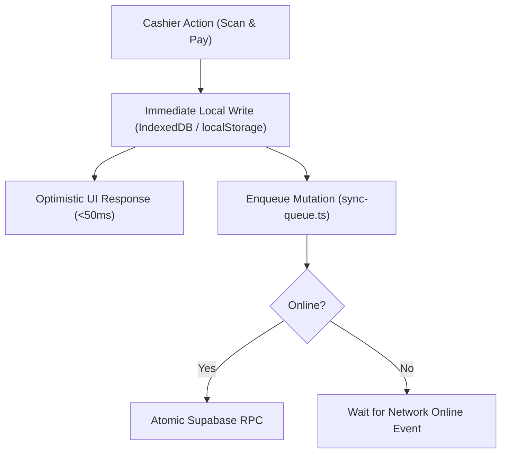

# ADR-0001: Offline-First Hybrid Architecture

## 📌 Context & Problem Statement
FlowPOS Pro is deployed in retail environments (supermarkets, electronics, pharmacies) where internet connectivity is frequently intermittent or absent. A standard cloud-dependent POS creates cashier downtime, customer queues, and revenue loss whenever connectivity drops.

## 🎯 Decision Drivers
* Instant cashier checkout (sub-50ms barcode scanning & invoice creation).
* 100% offline checkout functionality (sales, debt sales, refunds, expenses).
* Zero data loss upon sudden power cut or app restart.
* Eventual consistency with remote Supabase cloud when internet restores.

## ✅ Decision Outcome
Chosen option: **Two-Tier Storage with Mutation Queue (Optimistic Offline-First)**.

1. **Local Layer:**
   * IndexedDB (`hyperpos_cache`) stores product catalog with barcode search indexes.
   * `sync_queue` stores pending mutations encrypted via `secure-storage.ts`.
2. **Cloud Layer:**
   * Supabase PostgreSQL with Row-Level Security (RLS) and stored procedures (`process_pos_sale_atomic`).
3. **Synchronization Engine:**
   * Background runner (`sync-queue.ts` & `sync-operation-processor.ts`) pushes queued operations with backoff retry and collision avoidance.

### Consequences
* **Positive:**
  * Cashiers can sell uninterrupted without internet for days.
  * Instant search response regardless of network latency.
* **Tradeoffs:**
  * Requires robust conflict resolution and rollback handling on synchronization failure.

