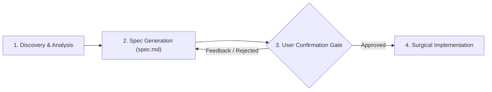

# 01 — Spec-Driven Planning Engine (FlowPOS Pro Protocol)

## 🎯 Core Directive
**NEVER modify production code directly for non-trivial features, refactors, or cross-cutting fixes.**
Any task that modifies more than one file, alters local/cloud storage schemas, touches financial formulas, or affects the offline sync engine MUST follow the **Spec-Driven Planning Protocol**.

---

## 📋 The 3-Phase Lifecycle

### Phase 1: Deep Discovery & Invariant Check
Before writing any specification:
1. Scan affected stores (`src/lib/*-store.ts`), cloud synchronization handlers (`src/lib/cloud/*`), and UI components.
2. Check if the task touches **frozen modules** (e.g., `Warehouses.tsx`, `StockTransfer.tsx`, `warehouses-cloud.ts`). If so, halt and warn the user.
3. Check currency impact: Ensure USD remains the immutable base accounting currency.

### Phase 2: Spec Generation (`spec.md`)
Generate a structured specification using `.agent/templates/spec_template.md`. The spec MUST explicitly document:
* **Feature Summary & Business Intent:** Why this is needed from a retail POS perspective.
* **Storage & Schema Impact:**
  * Local: Changes to `IndexedDB` (`hyperpos_cache`), `localStorage` (`safe-storage.ts`, `secure-storage.ts`), or memory stores.
  * Remote: Supabase tables, migrations, RLS policies, RPC functions.
* **Offline-First & Sync Edge Cases:**
  * Mutation queuing in `sync-queue.ts` (`QueuedOperation` type and payload).
  * Behavior when offline (immediate optimistic UI vs queued background sync).
  * Conflict resolution strategy and idempotency key uniqueness.
  * Cancellation registry check (`isOperationCancelled`).
* **Platform Matrix Verification:**
  * Web (PWA / Service Worker)
  * Android (Capacitor 8 / Native plugins)
  * Desktop (Electron)
* **Visual & Notification Experience:**
  * Alignment with RTL Arabic layout.
  * In-app notification via Dynamic Island `SmartToast` (category, color, sound).
* **Step-by-Step Execution Plan:** Atomic, verifiable stages.

### Phase 3: The User Confirmation Gate
* Present the spec clearly to the user.
* Request explicit confirmation before proceeding to write code.
* Do NOT run code modifications until approval is given.
