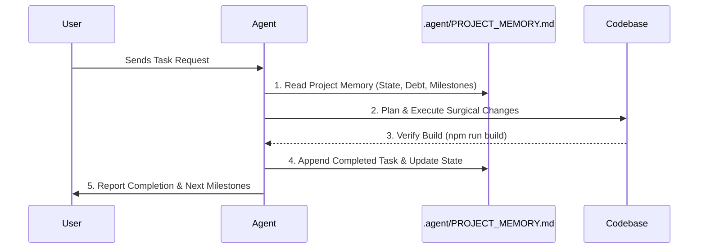

# 04 — Persistent Project Memory System (Claude-Mem Protocol)

## 🎯 Core Directive
**Guarantee cross-session continuity and prevent architectural drift.**
Every agent working on this repository must read from and write to the central persistent memory file: `.agent/PROJECT_MEMORY.md`.

---

## 🔄 The Memory Lifecycle

### 1. Read-On-Start Requirement
* Before initiating any planning or implementation, the agent MUST inspect `.agent/PROJECT_MEMORY.md`.
* Retrieve:
  * Current release version and recent commits.
  * Active schema migrations and offline sync features.
  * Known edge cases, quirks, or temporary workarounds.
  * The frozen module list.

### 2. Update-On-Finish Requirement
* After completing code modifications and verifying clean compilation:
* The agent MUST update `.agent/PROJECT_MEMORY.md` under the following sections:
  * **Recent Implementations:** Date, commit hash/summary, and exact file list.
  * **Active System State:** Any new storage keys, sync queue operation types, or UI components added.
  * **Known Debt & Edge Cases:** Any deferred items or caveats discovered during the work.
  * **Next Roadmap Milestones:** The logical next steps for the engineering team.
