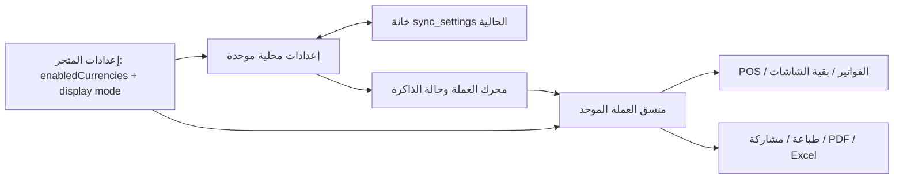

# [FEATURE/FIX]: إيقاف إعادة تفعيل TRY/SYP وتوحيد عرض العملة

**حالة الوثيقة:** ✅ معتمدة ومنفذة
**التاريخ:** 2026-10-27
**الفرع الحالي:** `event-or-artifact`
**النطاق:** تفعيل العملات حسب إعداد المتجر صراحةً، تهذيب سلة POS، واختيار نمط عرض العملة عبر واجهات ومخرجات النظام.

---

## 1. الهدف والسياق

- منع القيم الافتراضية ومسارات التوافق من إعادة تفعيل TRY أو SYP لمجرد غياب المفتاح أو وجود سعر صرف قديم.
- اعتماد `enabledCurrencies` المحفوظ صراحةً مرجعاً وحيداً للعملات الإضافية المعروضة؛ تبقى USD مفعلة دائماً كعملة الأساس.
- إزالة المساحة الزائدة في تذييل السلة وشارة العملة المكررة في حقل المقبوض، مع فصل رمز العملة عن الرقم بصرياً ومعالجة الصفر والإدخال الفارغ دون كسور غير لازمة.
- إضافة نمط عرض محفوظ لكل عملة: `symbol` أو `name` أو `both`، بما يمنع إطفاء الاسم والرمز معاً.
- تطبيق النمط على الشاشات والطباعة والمشاركة والتقارير والتصدير، مع الحفاظ على بيانات المبالغ واللقطات التاريخية.

## 2. السلوك المتوقع ومعايير القبول

1. لا يُفعّل أي كود غير USD تلقائياً بسبب غياب `enabledCurrencies[code]` أو وجود معدل صرف فقط. تظل العملات المعرفة في الكتالوج متاحة للاختيار، لكنها غير معروضة حتى يفعّلها المستخدم.
2. تبقى العملات المفعلة صراحةً مفعلة عبر تحميل الإعدادات المحلية والسحابية، ولا تتحول خانات TRY/SYP القديمة إلى عملة أخرى إلا عندما تكشف بياناتها المخزنة هوية العملة المعروفة وفق قواعد التطبيع القائمة.
3. لا تعرض معادلة العملات في الفاتورة عملة غير مفعّلة، ولا تستخدم معدل 1 كبديل لعملة غير USD عند غياب معدل صالح. تظل قيمة العملة الأصلية للفاتورة معروضة من لقطة الفاتورة حتى إن عُطلت العملة لاحقاً، ولا تُنشأ لها بطاقات تحويل إضافية.
4. لا يظهر شريط «عملة الفاتورة» المكرر في سلة POS. يبقى تحكم الضريبة فقط عند استحقاقه، ويظهر رمز عملة المقبوض مرة واحدة أو يُستبدل بالاسم بحسب النمط المختار.
5. يفصل صف الإجمالي العملة عن القيمة بعنصرين ومسافة مرئية؛ الحقل الفارغ يبقى فارغاً، والصفر لا ينتج كسوراً أو أصفاراً زائدة.
6. توفر الإعدادات لكل عملة خيارات متبادلة الاستبعاد: الرمز فقط، الاسم فقط، أو كلاهما. لا توجد حالة «لا رمز ولا اسم»، والقيمة الافتراضية للعملات القديمة هي `symbol` للحفاظ على العرض الحالي.
7. تتطابق تسميات العملات بين POS والفواتير وباقي الشاشات ومخرجات الطباعة والمشاركة والتقارير وملفات PDF/Excel؛ ولا يتغير أي مبلغ أو تقريب أو معدل صرف.
8. يبقى USD أساس المحاسبة، ولا تُعدّل قاعدة البيانات أو SQL/RPC أو مخطط IndexedDB.

## 3. المعمارية والتخزين والتزامن

### محلياً
- إضافة `currencyDisplayMode?: Record<string, 'symbol' | 'name' | 'both'>` إلى إعدادات المتجر الموحدة، وقراءة/حفظ القيمة داخل `hyperpos_settings_v1`.
- لا تغيير في مفاتيح التخزين الحالية ولا ترحيل هدّام؛ البيانات القديمة التي لا تحتوي الخيار تستخدم `symbol`.
- إزالة افتراض تفعيل TRY/SYP من قراءة الإعدادات الموحدة ومن بناء خرائط hook. إزالة الاستدلال من وجود exchange rate فقط في محرك المال، مع إبقاء تعريفات العملات ككتالوج/بيانات وصفية قابلة للاختيار.

### السحابة والعمل دون اتصال
- تمرير نمط العرض داخل `sync_settings` القائم على الإعدادات الموحدة، ودمجه بين المحلي والسحابي، وإبقاؤه ضمن طابور تحديث إعدادات المتجر الحالي عند عدم الاتصال.
- عدم إضافة جدول أو عمود أو RPC أو migration. لا تتغير أنواع عمليات البيع أو مفاتيح idempotency أو منطق المزامنة المالي.
- تغييرات نمط العرض تؤثر على التنسيق فقط؛ لا تُعدّل فواتير محفوظة أو سجلات مالية.

## 4. خطة التنفيذ والملفات المستهدفة

### المرحلة A — مصدر حقيقة العملات
- `src/lib/store-settings-sync.ts`: أنواع/افتراضات الإعدادات، القراءة، دمج السحابة، الحمولة والحفظ لـ `enabledCurrencies` و`currencyDisplayMode`.
- `src/lib/money-engine.ts`: منع تفعيل عملة بسبب معدل قديم وحده، مع المحافظة على USD وعلى تفعيل صريح أو العملة الأساسية المختارة.
- `src/hooks/use-currency.tsx`: إنشاء خرائط العملات من حالة المحرك فقط، دون ملء TRY/SYP على نحو مفروض.
- `src/pages/Settings.tsx` و`src/components/setup/SetupWizard.tsx`: الحفاظ على الاختيار الصريح عند تحميل/حفظ خانات العملة القديمة وإضافة خيارات نمط العرض لكل عملة.

### المرحلة B — عرض الفاتورة والسلة
- `src/pages/Invoices.tsx`: إزالة متغيرات TRY/SYP الثابتة، الاقتصار على العملات المفعلة ذات المعدل الصالح، واحترام نمط العرض مع إبقاء لقطة العملة التاريخية للفواتير كما هي.
- `src/components/pos/CartPanel.tsx`: تقليل تكرار واجهة العملة، تبسيط المقبوض والإجمالي، وإظهار تنسيق الصفر/القيمة الفارغة بوضوح.

### المرحلة C — التنسيق المشترك والمخرجات
- `src/lib/utils.ts` أو مساعد عملة مشترك جديد: إضافة formatter مقيّد بكود العملة والاسم والرمز ونمط العرض، دون استنتاج الهوية من رمز مخصص وحده.
- مراجعة وتوصيل نقاط تنسيق الأموال في `src/lib/native-print.ts`, `src/lib/native-share.ts`, `src/lib/share-utils.ts`, `src/lib/pdf-export.ts`, `src/lib/excel-export.ts`، ثم الشاشات/التقارير التي تنشئ نصوصاً مالية مباشرة.
- يظل ترتيب الرموز ومواقعها والتنسيق العربي/RTL متوافقاً مع السلوك الحالي، مع فاصل مقروء في عروض POS.

### الاختبارات والتوثيق
- إضافة اختبارات لتفعيل العملات الصريح، عدم الإحياء من المعدلات وحدها، توافق إعدادات TRY/SYP الموروثة، أنماط العرض الثلاثة، وغياب أي نمط فارغ.
- إضافة اختبارات تنسيق الفاتورة/المخرجات والتحقق من `0` والقيم الفارغة.
- تحديث `.agent/PROJECT_MEMORY.md` والـ ADR عند اعتماد القرار، ثم فحص المجالات والبناء.

## 5. مخطط تدفق مبسط

## 6. التوافق والمنصات

- الويب/PWA: نفس تخزين الإعدادات وحالة العملات الحالية، دون تعديل Service Worker.
- Android/Capacitor وElectron: استخدام formatter مشترك خالص لا يعتمد على واجهات منصة؛ لا استدعاءات أصلية جديدة.
- دعم RTL والعربية والإنجليزية، وتجنب قص أسماء العملات في الشاشات الضيقة.

## 7. المخاطر والضوابط

- **خطر إخفاء عملة تاريخية:** يبقى مبلغ الفاتورة الأصلي ورمزه/اسمه من الـ snapshot؛ الإخفاء يقتصر على بطاقات العملات البديلة غير المفعلة.
- **خطر إيقاف عملة قديمة للمستخدمين:** لا تعتمد التهيئة على وجود معدل، لكن يتم احترام كل قيمة تفعيل صريحة وبيانات هوية العملة الموروثة المعروفة. تُختبر إعدادات QAR/EGP الموجودة في خانات TRY/SYP.
- **خطر تخصيص الرمز:** لا يُستنتج كود العملة من رمز حرّ؛ يمرر كود العملة صراحةً إلى المنسق.
- **خطر اتساع التغيير:** تُستخدم دالة تنسيق مشتركة وتُراجع كل نقاط الطباعة/المشاركة/التصدير ذات الصلة دون إعادة كتابة ملفات كاملة.
- **التراجع:** إعادة commit التغيير البرمجي تعيد تنسيق العرض فقط؛ لا توجد عملية مالية أو migration يلزم عكسه.

## 8. التحقق المنفذ

1. `npx tsc --noEmit` — ناجح.
2. `npm run build` — ناجح؛ بقيت تحذيرات تقسيم الحزم الموجودة من Vite.
3. `git diff --check` — ناجح.
4. لا يحتوي `package.json` على سكربت اختبار؛ لم تُضف تبعيات أو بنية اختبار جديدة.
5. فحص ESLint للملفات المعدلة يعرض مخالفات موجودة مسبقاً في الملفات الكبيرة (مثل `any` وكتل `catch` الفارغة)، لذا لم تُوسّع هذه المهمة لإصلاحها.

**الموافقة:** أكد المستخدم بدء التنفيذ قبل تعديل ملفات الإنتاج. لا تغيير في USD base accounting أو SQL/RPC أو مخطط IndexedDB.
