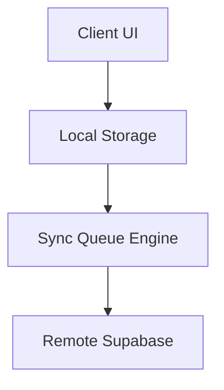

# ADR-XXXX: <Title>

## 📌 Context & Problem Statement
Describe the architectural dilemma or business requirement that necessitated a decision. What constraints, tradeoffs, or platform limitations were present?

---

## 🎯 Decision Drivers
* Driver 1 (e.g. Offline availability in areas with unstable internet)
* Driver 2 (e.g. Zero latency during barcode scanning)
* Driver 3 (e.g. Accurate multi-currency accounting with USD base)

---

## 💡 Considered Options
1. **Option 1:** <Description>
2. **Option 2:** <Description>
3. **Option 3:** <Description>

---

## ✅ Decision Outcome
Chosen option: **Option X** because <justification>.

### Consequences
* **Positive:**
  * Benefit 1
  * Benefit 2
* **Negative / Tradeoffs:**
  * Added complexity in ...
  * Requires extra sync queue handling ...

---

## 🏗️ Architecture & Data Flow

---

## 🔗 Related Documents
* [[ADR-0001-offline-first-hybrid-architecture]]
* [[PROJECT_MEMORY]]
